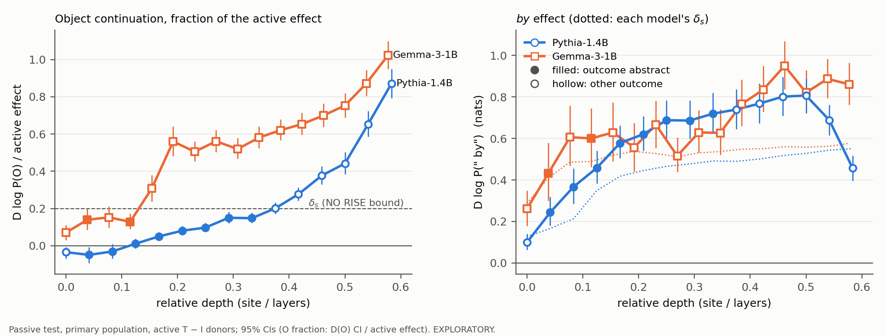

# Passive-only depth curve, 0 to ~60% depth (EXPLORATORY)

Generated by `scripts/analyze_depth_curve.py` (sources and definitions in its docstring; rules in `exploratory.md`, section 6). Passive test, primary population, all bands, D on bad passive bases (active T − I donors), 95% CIs. O fraction = D(O) / the site's held-out active effect; δ_s is 0.2 on that scale. "new" = run in this batch (results/gemma/das/depth_curve).

Reproduction anchors (rerun in the new directories, all transfer_summary rows at the site): Gemma-3-1B site 5: 7320 / 7320 rows, unmatched (incl. class changes) 0, max |diff| 0 on the effects and CIs (nats), 0 on the ratios to the natural gap; Pythia-1.4B site 4: 7320 / 7320 rows, unmatched (incl. class changes) 0, max |diff| 0.00164 on the effects and CIs (nats), 0.093 on the ratios to the natural gap.

| model | site | depth | run | active effect | δ_s | D log P(O) | class | O fraction [95% CI] | D log P(" by") | class | D(by) / natural gap | outcome |
|---|---:|---:|---|---:|---:|---|---|---|---|---|---:|---|
| Gemma-3-1B | 0 | 0.00 | stored | 1.44 | 0.29 | +0.10 [+0.04, +0.16] | NO RISE | +0.07 [+0.03, +0.11] | +0.26 [+0.18, +0.35] | unresolved | 0.64 | unresolved |
| Gemma-3-1B | 1 | 0.04 | stored | 2.05 | 0.41 | +0.29 [+0.18, +0.40] | NO RISE | +0.14 [+0.09, +0.20] | +0.43 [+0.30, +0.58] | RISE | 1.05 | abstract (takes an object) |
| Gemma-3-1B | 2 | 0.08 | stored | 2.43 | 0.49 | +0.37 [+0.24, +0.51] | unresolved | +0.15 [+0.10, +0.21] | +0.61 [+0.47, +0.76] | RISE | 1.48 | unresolved |
| Gemma-3-1B | 3 | 0.12 | stored | 2.45 | 0.49 | +0.31 [+0.22, +0.42] | NO RISE | +0.13 [+0.09, +0.17] | +0.60 [+0.46, +0.75] | RISE | 1.46 | abstract (takes an object) |
| Gemma-3-1B | 4 | 0.15 | stored | 2.60 | 0.52 | +0.80 [+0.61, +0.98] | RISE | +0.31 [+0.24, +0.38] | +0.63 [+0.49, +0.77] | RISE | 1.53 | mixed |
| Gemma-3-1B | 5 | 0.19 | stored | 2.69 | 0.54 | +1.50 [+1.29, +1.72] | RISE | +0.56 [+0.48, +0.64] | +0.56 [+0.44, +0.67] | RISE | 1.36 | mixed |
| Gemma-3-1B | 6 | 0.23 | new | 2.64 | 0.53 | +1.33 [+1.20, +1.48] | RISE | +0.50 [+0.45, +0.56] | +0.67 [+0.55, +0.78] | RISE | 1.63 | mixed |
| Gemma-3-1B | 7 | 0.27 | new | 2.56 | 0.51 | +1.43 [+1.29, +1.59] | RISE | +0.56 [+0.50, +0.62] | +0.52 [+0.44, +0.61] | RISE | 1.26 | mixed |
| Gemma-3-1B | 8 | 0.31 | stored | 2.65 | 0.53 | +1.38 [+1.24, +1.53] | RISE | +0.52 [+0.47, +0.58] | +0.63 [+0.53, +0.74] | RISE | 1.53 | mixed |
| Gemma-3-1B | 9 | 0.35 | new | 2.68 | 0.54 | +1.56 [+1.41, +1.72] | RISE | +0.58 [+0.53, +0.64] | +0.63 [+0.52, +0.74] | RISE | 1.53 | mixed |
| Gemma-3-1B | 10 | 0.38 | new | 2.74 | 0.55 | +1.70 [+1.55, +1.86] | RISE | +0.62 [+0.57, +0.68] | +0.77 [+0.66, +0.88] | RISE | 1.87 | mixed |
| Gemma-3-1B | 11 | 0.42 | new | 2.75 | 0.55 | +1.80 [+1.64, +1.97] | RISE | +0.65 [+0.60, +0.71] | +0.83 [+0.73, +0.95] | RISE | 2.03 | mixed |
| Gemma-3-1B | 12 | 0.46 | stored | 2.80 | 0.56 | +1.96 [+1.79, +2.14] | RISE | +0.70 [+0.64, +0.76] | +0.95 [+0.84, +1.07] | RISE | 2.32 | mixed |
| Gemma-3-1B | 13 | 0.50 | new | 2.79 | 0.56 | +2.10 [+1.92, +2.28] | RISE | +0.75 [+0.69, +0.82] | +0.82 [+0.72, +0.93] | RISE | 2.00 | mixed |
| Gemma-3-1B | 14 | 0.54 | new | 2.81 | 0.56 | +2.45 [+2.26, +2.65] | RISE | +0.87 [+0.81, +0.94] | +0.89 [+0.79, +0.98] | RISE | 2.16 | mixed |
| Gemma-3-1B | 15 | 0.58 | stored | 2.88 | 0.58 | +2.94 [+2.74, +3.17] | RISE | +1.02 [+0.95, +1.10] | +0.86 [+0.76, +0.96] | RISE | 2.10 | mixed |
| Pythia-1.4B | 0 | 0.00 | new | 0.64 | 0.13 | -0.02 [-0.04, -0.00] | NO RISE | -0.03 [-0.07, -0.01] | +0.10 [+0.06, +0.14] | unresolved | 0.14 | unresolved |
| Pythia-1.4B | 1 | 0.04 | new | 0.83 | 0.17 | -0.04 [-0.08, -0.01] | NO RISE | -0.05 [-0.09, -0.01] | +0.24 [+0.18, +0.32] | RISE | 0.34 | abstract (takes an object) |
| Pythia-1.4B | 2 | 0.08 | new | 1.07 | 0.21 | -0.03 [-0.07, +0.01] | NO RISE | -0.03 [-0.07, +0.01] | +0.37 [+0.29, +0.46] | RISE | 0.51 | abstract (takes an object) |
| Pythia-1.4B | 3 | 0.12 | new | 1.74 | 0.35 | +0.02 [-0.03, +0.07] | NO RISE | +0.01 [-0.01, +0.04] | +0.46 [+0.38, +0.54] | RISE | 0.64 | abstract (takes an object) |
| Pythia-1.4B | 4 | 0.17 | stored | 2.09 | 0.42 | +0.10 [+0.06, +0.15] | NO RISE | +0.05 [+0.03, +0.07] | +0.58 [+0.50, +0.66] | RISE | 0.81 | abstract (takes an object) |
| Pythia-1.4B | 5 | 0.21 | new | 2.23 | 0.45 | +0.18 [+0.13, +0.24] | NO RISE | +0.08 [+0.06, +0.11] | +0.62 [+0.54, +0.71] | RISE | 0.87 | abstract (takes an object) |
| Pythia-1.4B | 6 | 0.25 | stored | 2.33 | 0.47 | +0.23 [+0.17, +0.29] | NO RISE | +0.10 [+0.07, +0.12] | +0.69 [+0.60, +0.78] | RISE | 0.96 | abstract (takes an object) |
| Pythia-1.4B | 7 | 0.29 | new | 2.39 | 0.48 | +0.36 [+0.29, +0.44] | NO RISE | +0.15 [+0.12, +0.18] | +0.69 [+0.60, +0.78] | RISE | 0.96 | abstract (takes an object) |
| Pythia-1.4B | 8 | 0.33 | stored | 2.46 | 0.49 | +0.36 [+0.30, +0.44] | NO RISE | +0.15 [+0.12, +0.18] | +0.72 [+0.63, +0.82] | RISE | 1.01 | abstract (takes an object) |
| Pythia-1.4B | 9 | 0.38 | new | 2.45 | 0.49 | +0.49 [+0.42, +0.57] | RISE | +0.20 [+0.17, +0.23] | +0.74 [+0.64, +0.84] | RISE | 1.04 | mixed |
| Pythia-1.4B | 10 | 0.42 | stored | 2.50 | 0.50 | +0.69 [+0.60, +0.78] | RISE | +0.28 [+0.24, +0.31] | +0.77 [+0.67, +0.86] | RISE | 1.08 | mixed |
| Pythia-1.4B | 11 | 0.46 | new | 2.59 | 0.52 | +0.97 [+0.85, +1.11] | RISE | +0.38 [+0.33, +0.43] | +0.80 [+0.71, +0.90] | RISE | 1.12 | mixed |
| Pythia-1.4B | 12 | 0.50 | stored | 2.64 | 0.53 | +1.17 [+1.01, +1.33] | RISE | +0.44 [+0.38, +0.50] | +0.81 [+0.72, +0.89] | RISE | 1.13 | mixed |
| Pythia-1.4B | 13 | 0.54 | new | 2.72 | 0.54 | +1.77 [+1.59, +1.97] | RISE | +0.65 [+0.59, +0.72] | +0.69 [+0.62, +0.76] | RISE | 0.97 | mixed |
| Pythia-1.4B | 14 | 0.58 | stored | 2.76 | 0.55 | +2.40 [+2.19, +2.61] | RISE | +0.87 [+0.79, +0.95] | +0.46 [+0.40, +0.52] | NO RISE | 0.64 | surface (object next) |
