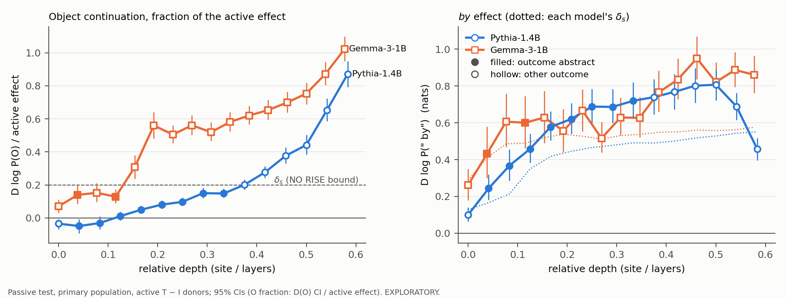

# Gemma replication: exploratory / secondary analyses

**Everything in this file is exploratory or secondary.** It does not replace the declared results in
`controls_transfer.md` and `transfer.md`:
- the declared sites are 15 (frozen rule), 12 (within 0.05 of max) and 5 / 8 (Pythia's secondary-site rule);
- the declared passive outcome is the active-donor test.

## Rules, stated before running (2026-11-06)

### 1. IIA-matched sites

**Rule:**
- Take each of Pythia's abstract-reading sites, 4, 6 and 8.
- Match it to the Gemma site whose sweep best-epoch active IIA is closest to that Pythia site's sweep
  best-epoch active IIA. Ties go to the earlier site.
  - The quantity is the same for both models: the best epoch's fold-mean held-out cross-class IIA (split 0,
    5 folds).
  - Pythia's is read from `results/das_round2/sweep_strict/sweep.csv`, Gemma's from
    `results/gemma/das/sweep_strict/sweep.csv`.
  - Candidate Gemma sites are 0–25; the last site, 26 (post-final-norm states), is excluded.
- Epochs come from the frozen epoch rule: the smallest epoch within 0.01 of the site's best. Rank is 1, as at
  every other Gemma transfer site.

**Result of the rule** (computed before any evaluation; configs `results/gemma/das/transfer/frozen_config_site{0,1,4}.json`):

| Pythia site | Pythia IIA | Gemma site | Gemma IIA | distance | runner-up (distance) | epochs |
|---:|---:|---:|---:|---:|---|---:|
| 4 | 0.4544 | 0 | 0.3572 | 0.0972 | 2 (0.1829) | 2 |
| 6 | 0.6694 | 1 | 0.6847 | 0.0153 | 2 (0.0322) | 1 |
| 8 | 0.8026 | 4 | 0.7933 | 0.0092 | 3 (0.0415) | 2 |

Two flags:
- Gemma site 0 is the embedding output; a rank-1 patch there acts on the participle's input embedding alone.
  Exactly (checked 2026-11-09):
  - It is the output of a forward hook on `model.embed_tokens` (`model_arch.ARCH`, `Runner.patched`).
  - That module is `Gemma3TextScaledWordEmbedding` (transformers 4.57.6), whose forward returns the embedding
    row times `embed_scale` cast to the weight dtype: √1152 = 33.94, which is 34.0 in bf16.
  - So site 0 is the scaled token embedding entering block 0, not the output of block 0. Gemma adds no
    positional embedding there (rotary), so the state is the same in every context.
  - At start-up the runner asserts that the hooked output equals `output_hidden_states[0]`
    (`site_check_max_abs_sites_0_to_L-1` = 0.0 in every run).
  - Pythia's site 0 is the same, `gpt_neox.embed_in`, with no scaling.
- Its match is loose: 0.097, against 0.015 and 0.009 for the other two. Gemma has no site between 0.36
  (site 0) and 0.64 (site 2).

**Run:**
- Final runs: `run_das_round2.py final`, 3 splits × 5 folds.
- The full existing chain (`jobs/transfer_chain.sh`):
  - prep: bases, TOST bounds, builders;
  - main: passive test, OR / TC, in range;
  - fg: filler-gap, round-5 C8 protocol.
- The chain runs at all seven Gemma sites 0, 1, 4, 5, 8, 12, 15 with the unchanged runners and analyses, so
  every site shares one table. The declared sites 5 / 8 / 12 / 15 must reproduce their committed numbers
  exactly.

### 2. In-range equivalence test (secondary)

**Rule:** apply the passive test's own classes to the in-range passive O effect, D_in(O) = R(t_T) − R(t_I) on
bad passive items (`inrange_summary.csv`):
- RISE = 95% CI > 0 and estimate ≥ δ_s;
- FALL = 95% CI < 0 and estimate ≤ −δ_s;
- NO RISE = 90% CI within ±δ_s;
- otherwise unresolved.

The code is `analyze_passive_test.classify`.

Details:
- δ_s is the same site-specific bound as the declared passive test (`deltas.json`, 0.2 × the site's held-out
  active ΔlogP(O)).
- The CIs are the in-range analysis's own two-way bootstrap (pairs within band × contexts; 2,000 draws, seed 17).
  The declared test's three-way bootstrap also resamples donor pairs, which the in-range patch has none of.
- Scope: both models, every run site. Pythia: 4, 6, 8, 10, 12, 14, 16, 17. Gemma: 0, 1, 4, 5, 8, 12, 15.
- D_in(*by*) gets the same classes. The pair (O class, *by* class) gives an in-range outcome under the same
  surface / abstract / mixed rule. This is a secondary reading.

### 3. Balanced shuffled-label control

**Rule** (`scripts/run_das_shuffle_balanced.py`): 20 permutations per site.
- **Labels.** In each permutation, for each split × fold of the site's final run, take the fold's training
  verbs. Relabel exactly half of the transitive verbs as intransitive and exactly half of the intransitive
  verbs as transitive.
  - A class with an odd count n flips floor(n/2) or ceil(n/2), chosen at random. This keeps the correlation 0 in
    expectation and |phi| ≤ 0.043 on these folds; phi is recorded per fold.
  - Verbs outside the training set keep their labels.
- **Training.** As the site's final run trains (`run_das_round2.train`), with the same rank, epochs, learning
  rate, swaps and batch.
- **Evaluation.** On the fold's held-out swaps with the true classes (`run_das_round2.evaluate` /
  `summarize`). The items and folds must equal the final run's.
- **Statistic.** Each permutation's held-out cross-class IIA is averaged over its 15 folds. Over the 20
  permutations the report gives the mean and the 95th percentile, next to the final run's unconstrained
  shuffled-label mean and the trained DAS mean.
- **Sites.** Gemma 0, 1, 4, 5, 8, 12, 15; Pythia 8, 12, 17, from Pythia's stored final runs. Pythia's outputs
  go under `results/gemma/das/shuffle_balanced/`; the Pythia results are untouched.

No nonce runs.

## Rules for the second batch, stated before running (2026-11-09)

### 4. Gemma sites 2 and 3 through the full chain

These complete the early span: sites 0–4 are then all run.
- Configs: `results/gemma/das/transfer/frozen_config_site{2,3}.json`.
  - Epochs come from the frozen epoch rule on Gemma's sweep: 2 at site 2 (sweep IIA 0.637) and 1 at site 3
    (0.761). Rank 1.
  - The same rule reproduces the stored epochs at Gemma 0 / 1 / 4 / 5 / 8 and Pythia 4 / 6 / 8.
- Pipeline as for the matched sites:
  - final runs, 3 splits × 5 folds;
  - the full chain at sites 0, 1, 2, 3, 4, 5, 8, 12, 15.
- Every site run before must reproduce its committed numbers exactly.

### 5. Embedding-level class axis, both models

Script: `scripts/analyze_embedding_axis.py`, with every definition in its docstring.

**Verbs:** the DAS verbs in both models' final runs (after each model's behaviour filter) whose participle is one
token in both tokenizers, in the DAS prompt context. That gives 26 verbs: 13 T, 13 I.

**Vectors:**
- Gemma: rows of the tied embedding matrix.
- Pythia: rows of `embed_in` and of `embed_out`, separately.
- All in fp32.

**(a) Probe:** T vs I, verb-held-out, on each model's own DAS folds (3 splits × 5 folds; a verb is held out with
its pair).
- Classifiers: L2 logistic regression (C = 1, features standardized on the training verbs), and the
  mean-difference classifier.
- Accuracy is the mean over the 3 splits.
- 95% CI: a verb bootstrap (2,000 draws).
- Null: 200 label permutations through the same procedure.

**(b) Cosines:** |cos| between the class mean-difference axis (all 26 verbs) and the rank-1 DAS direction of
every split × fold (15).
- Sites: Gemma 0–5 and Pythia 0–8.
- Pythia's stored final runs exist only at 4 / 6 / 8. For 0–3, 5 and 7, new exploratory Pythia final runs use
  the frozen epoch rule on Pythia's sweep (epochs 1 / 1 / 1 / 2 / 2 / 2).
  - Configs: `results/gemma/das/pythia_early/frozen_config_site*.json`.
  - Outputs go under `results/gemma/das/pythia_early/`; the stored Pythia results are not touched.
- References:
  - 10,000 random unit directions (mean |cos|, 95th pct; expected mean √(2/(πd)), rms 1/√d);
  - the mean-difference axis under 1,000 label permutations of the same verbs, a reference for anisotropy.

## Results (run 2026-11-06/07; tables: `exploratory_tables.md`, `transfer.md`)

**Reproduction:** rerunning the chain at seven sites left every declared-site output unchanged: all summary
CSVs match row for row (max diff 0), the base vectors are bit-identical, and the run checks pass at every site
(self-patch / self-set max |dM| 0 in bf16, ≤ 2.3e-5 in fp32; held-out recompute max ≤ 0.091). The declared results stand as
reported in `controls_transfer.md`.

### 1. IIA-matched sites: transfer (exploratory)

Final-run DAS IIA (15 folds): Gemma 0.34 / 0.63 / 0.81 at sites 0 / 1 / 4; Pythia 0.45 / 0.66 / 0.78 at
sites 4 / 6 / 8. So the final runs keep the sweep match at sites 1 and 4 (within 0.03) and widen the gap at site 0
(0.11 below Pythia 4). Norm-matched random directions give ≤ 0.02.

**Passive (*by*), primary population, active donors**, same rule as declared:

| Pythia site → Gemma site | Pythia O / *by* | Pythia outcome | Gemma O / *by* (δ_s) | Gemma outcome |
|---|---|---|---|---|
| 4 → 0 | +0.10 NO RISE / +0.58 RISE | abstract | +0.10 [+0.04, +0.16] NO RISE / +0.26 [+0.18, +0.35] unresolved (0.29) | unresolved |
| 6 → 1 | +0.23 NO RISE / +0.69 RISE | abstract | +0.29 [+0.18, +0.40] NO RISE / +0.43 [+0.30, +0.58] RISE (0.41) | **abstract** |
| 8 → 4 | +0.36 NO RISE / +0.72 RISE | abstract | +0.80 [+0.61, +0.98] RISE / +0.63 [+0.49, +0.77] RISE (0.52) | mixed |

- One of three matched sites reads abstract: Gemma site 1 (depth 0.04, the first layer's output), matched to
  Pythia 6 at distance 0.015. It is a narrow reading:
  - *by* +0.43 clears δ_s (0.41) by 0.02;
  - O +0.29 is NO RISE (90% CI upper 0.38 < 0.41).
- At site 0, *by* rises (95% CI > 0) but stays below δ_s and is not equivalent to 0 either, so the outcome is
  unresolved. This is also the loosest match (0.097 in the sweep, 0.11 in the final run).
- Site 4 is the closest match (0.009), and it reads **mixed**, not abstract.
- O as a fraction of the site's active effect (δ_s / 0.2):

  | | Gemma site 0 | Gemma site 1 | Gemma site 4 | Gemma site 5 (declared) |
  |---|---|---|---|---|
  | O fraction | 0.07 | 0.14 | 0.31 | 0.56 |

  Pythia: 0.05 / 0.10 / 0.15 at sites 4 / 6 / 8. So the O fraction is close at the first two matches, but at
  the closest IIA match Gemma's is about twice Pythia's.
- *By* is smaller in Gemma at every match (+0.26 / +0.43 / +0.63 against +0.58 / +0.69 / +0.72). Gemma's
  natural *by* gap is smaller, so as a fraction of it D(*by*) is 0.64 / 1.05 / 1.53, against Pythia's
  0.81 / 0.96 / 1.01.

**OR / TC (T − I donors).** D(O) and D(L) rise at every matched Gemma site, except TC D(O) at site 1, which is
unresolved. The licensed continuation rises less than in Pythia at every match, and PREP falls less:
- OR MAIN +0.62 / +1.12 / +1.11, against +1.34 / +1.49 / +1.47;
- TC END +0.11 / +0.25 / +0.31, against +0.72 / +0.80 / +0.75;
- PREP: OR −0.17 / −0.33 / −0.46 against −0.57 / −0.64 / −0.63; TC −0.21 / −0.31 / −0.34 against
  −0.69 / −0.78 / −0.80.

TC D(O): Gemma +0.40 RISE / +0.38 unresolved / +0.65 RISE; Pythia +0.30 NO RISE / +0.37 unresolved / +0.92 RISE.

**In range** (ratio to the natural gap, Gemma 0 / 1 / 4 against Pythia 4 / 6 / 8). Gemma's in-range effects
at the matched sites are much smaller than Pythia's until site 4:
- OR MAIN 0.11 / 0.19 / 0.62 against 0.79 / 0.93 / 0.89;
- TC END 0.13 / 0.45 / 0.91 against 0.96 / 1.10 / 0.91;
- passive *by* 0.17 / 0.22 / 0.59 against 0.52 / 0.52 / 0.44.

Passive D_in(O) is near zero in both: +0.02 / +0.01 / +0.10 against +0.04 / +0.06 / +0.09.

**Filler-gap** (round-5 C8, non-DAS primary, half B):

| | Gemma 0 / 1 / 4 | Pythia 4 / 6 / 8 |
|---|---|---|
| embedded, T − I donors | mixed / **licensing-like** / surface | surface / surface / surface |
| embedded, in range | mixed / mixed / mixed | mixed / surface / mixed |
| matrix, T − I donors | mixed / **licensing-like** / surface | mixed / surface / surface |
| matrix, in range | mixed / mixed / surface | **licensing-like** / mixed / **licensing-like** |

- Gemma site 1 reads licensing-like with active donors in both frames. Pythia never does with active donors at
  any stored site (primary population).
- The site-1 labels follow the declared classifier. The O-level condition is "not above the T verbs' natural
  level": the estimates are below it, but both CIs include 0 (−0.11 [−0.63, +0.37] embedded, −0.35 [−0.79, +0.11]
  matrix).
  - In embedded wh the filler raises the patched O (fill − nofill +0.22 [+0.03, +0.44]), so the label does not
    mean O is suppressed.
  - Gemma has 16 / 26 I verbs against Pythia's 28 / 34.
- Pythia's licensing-like readings are in range, in matrix wh; Gemma has none in range at the matched sites.

**Reading (exploratory).**
- One tested IIA-matched site reproduces Pythia's early passive classification: site 1. There *by* rises, O is
  positive but within the equivalence bound (+0.29 [+0.18, +0.40], δ_s 0.41), and the filler-gap donor patches
  read licensing-like.
- It is a single site, at the first layer's output. Its passive reading clears the *by* bound by 0.02. The
  direction's effects on the licensed continuations there (OR MAIN, TC END, in range) are well below Pythia's.
- At the closest IIA match (site 4 ~ Pythia 8), Gemma is mixed, with twice Pythia's O fraction.
- So, among the tested sites, an abstract-looking reading appears in Gemma only at one early, low-IIA site,
  not over a span like Pythia's sites 4–8. Matching by IIA does not show how much IIA contributes to the
  declared depth difference. Gemma sites 2 / 3 (sweep IIA 0.64 / 0.76) were not run through the transfer chain.
  Three exploratory comparisons, not corrected for multiplicity.
  (Written before sites 2 / 3 were run. Their results, in the second batch below, revise the "one site" part:
  site 3 also reads abstract, and site 2 misses it on the O bound by 0.004.)
- The declared reading ("on the declared test, Gemma does not show Pythia's early abstract profile at the
  tested sites") is unchanged. It concerned the rule-picked sites.

### 2. In-range equivalence test (secondary)

D_in(O) on bad passive items against the declared δ_s:
- **Pythia: NO RISE at every site, 4–17** (+0.04 to +0.45; 90% CI upper ≤ 0.50 against δ_s 0.42–0.57).
- **Gemma: NO RISE at six of seven sites**, 0 / 1 / 4 / 5 / 12 / 15 (+0.02 / +0.01 / +0.10 / +0.27 / +0.40 / +0.43).
- **Unresolved at Gemma 8**: +0.50 [+0.45, +0.55]; 90% CI upper 0.54 > δ_s 0.53, and the estimate is below δ_s,
  so it is not RISE.

So with the coordinate set to the passives' own class means, neither model's direction raises the passive
object continuation past the equivalence bound, except one unresolved site. This supports the donor-scale
caveat in `controls_transfer.md`: the declared O RISE at Gemma 5 / 8 / 12 / 15 needs active-donor values.

Gemma's in-range O is still larger than Pythia's at matched depth (e.g. +0.27 / +0.50 at Gemma 5 / 8 against
+0.04 to +0.09 at Pythia 4–8). It is below the bound, not zero.

**The secondary in-range outcome is degenerate.** D_in(*by*) is NO RISE at every site in both models
(+0.04 to +0.37):
- δ_s is scaled to the active-donor effect on O (0.2 × ΔlogP(O)), and the in-range *by* effects are all smaller
  than that.
- So the in-range outcome is "nothing moves" everywhere, except unresolved at Gemma 8.

This says the in-range *by* effect is small next to an active-donor-scaled bound. It does not say *by* is
unaffected: D_in(*by*) is 0.17–0.89 of the natural *by* gap in Gemma and 0.06–0.52 in Pythia. The in-range outcome cannot tell abstract from
surface with this bound, and it should not be read as either.

### 3. Balanced shuffled-label control

20 permutations per site, each over the final run's 15 folds; |phi| between true and permuted training-verb
classes < 0.044 in every fold (max 0.0435). Held-out cross-class IIA:

| model | site | balanced mean | balanced p95 | unconstrained (final run) | trained DAS |
|---|---:|---:|---:|---:|---:|
| Gemma | 0 (expl.) | 0.11 | 0.12 | 0.12 | 0.34 |
| Gemma | 1 (expl.) | 0.21 | 0.25 | 0.24 | 0.63 |
| Gemma | 4 (expl.) | 0.24 | 0.29 | 0.26 | 0.81 |
| Gemma | 5 | 0.26 | 0.30 | 0.29 | 0.85 |
| Gemma | 8 | 0.31 | 0.34 | 0.35 | 0.88 |
| Gemma | 12 | 0.35 | 0.40 | 0.41 | 0.94 |
| Gemma | 15 | 0.37 | 0.43 | 0.41 | 0.98 |
| Pythia | 8 | 0.24 | 0.27 | 0.20 | 0.78 |
| Pythia | 12 | 0.28 | 0.31 | 0.24 | 0.90 |
| Pythia | 17 | 0.39 | 0.44 | 0.34 | 0.97 |

- **Trained DAS exceeds the balanced p95 at every site:**
  - by 0.22 at Gemma 0;
  - by 0.38–0.58 at the other sites: 0.38 at Gemma 1, 0.51–0.58 at Gemma 4–15 and Pythia 8–17;
  - it also exceeds the balanced maximum over permutations at every site (largest 0.45, Gemma 15 / Pythia 17).
- **Near-zero label correlation cannot fully account for the shuffled-label level.** With labels uncorrelated with the classes,
  the cross-class IIA is still 0.11–0.39 and rises with site in both models, well above norm-matched random
  directions (≤ 0.02). Single folds reach 0.82.
- **Balanced against unconstrained:**
  - Gemma's balanced mean is 0.014–0.065 below its unconstrained one at every site;
  - Pythia's is 0.04–0.05 above.
  - So the unconstrained control's model gap shrinks under balancing:
    - site 12: 0.41 vs 0.24 unconstrained, 0.35 vs 0.28 balanced;
    - at the IIA match Gemma 4 ~ Pythia 8: 0.24 vs 0.24;
    - final sites: Gemma 15 vs Pythia 17, 0.37 vs 0.39.
  - This suggests that the higher shuffled-label IIA reported for Gemma in `controls_transfer.md` partly reflects
    which permutations the unconstrained control drew. It is not established: the unconstrained control is one
    permutation per fold, so it gives no permutation distribution to compare against. Under the balanced control
    the two models are close at matched IIA.

No nonce runs.

## Results, second batch (run 2026-11-09; tables: `transfer.md`, `exploratory_tables.md`, `embedding_axis.md`)

**Exploratory.** Numbers only. Rules: sections 4 and 5 above.

**Reproduction:** rerunning the chain at nine sites left every output of the seven sites run before unchanged.
- All summary CSVs match row for row (max diff 0), and the earlier base vectors are bit-identical.
- Run checks at the new sites: self-patch / self-set max |dM| 0 in bf16 and ≤ 2.8e-5 in fp32 (filler-gap); held-out
  recompute max 0.053 / 0.074, median 0.
  The earlier sites range 0.057–0.091.

### 4. Gemma sites 2 and 3 through the full chain

**Final-run held-out cross-class IIA** (15 folds, rank 1):

| Gemma site | 0 | 1 | 2 | 3 | 4 | 5 |
|---|---:|---:|---:|---:|---:|---:|
| DAS IIA | 0.34 | 0.63 | 0.74 | 0.75 | 0.81 | 0.85 |

- Unconstrained shuffled labels: 0.30 / 0.24 at sites 2 / 3.
- Norm-matched random: 0.02 / 0.01.
- Site 2's final IIA (0.74) is above its sweep IIA (0.64, split 0 only).
- Pythia 4 / 6 / 8: 0.45 / 0.66 / 0.78.

**Passive (*by*), primary population, active donors** (declared rule):

| Gemma site | δ_s | D log P(O) | D log P(" by") | D log P(".") | outcome |
|---:|---:|---|---|---|---|
| 0 | 0.29 | +0.10 [+0.04, +0.16] NO RISE | +0.26 [+0.18, +0.35] unresolved | +0.01 NO RISE | unresolved |
| 1 | 0.41 | +0.29 [+0.18, +0.40] NO RISE | +0.43 [+0.30, +0.58] RISE | +0.27 NO RISE | abstract |
| **2** | 0.49 | +0.37 [+0.24, +0.51] unresolved | +0.61 [+0.47, +0.76] RISE | +0.45 unresolved | unresolved |
| **3** | 0.49 | +0.31 [+0.22, +0.42] NO RISE | +0.60 [+0.46, +0.75] RISE | +0.29 NO RISE | **abstract** |
| 4 | 0.52 | +0.80 [+0.61, +0.98] RISE | +0.63 [+0.49, +0.77] RISE | +0.34 NO RISE | mixed |
| 5 | 0.54 | +1.50 [+1.29, +1.72] RISE | +0.56 [+0.44, +0.67] RISE | −0.01 NO RISE | mixed |

- Site 2: O's 90% CI is [+0.26, +0.490] against δ_s 0.486, so it misses NO RISE by 0.004.
- Site 3: O's 90% CI upper bound is 0.40 < 0.49, and *by* clears δ_s by 0.11.
- O as a fraction of the active effect (δ_s / 0.2), sites 0–5: 0.07 / 0.14 / 0.15 / 0.13 / 0.31 / 0.56.
  Pythia 4 / 6 / 8: 0.05 / 0.10 / 0.15.
- D(*by*) / natural *by* gap, sites 0–5: 0.64 / 1.05 / 1.48 / 1.46 / 1.53 / 1.36.
  Pythia 4 / 6 / 8: 0.81 / 0.96 / 1.01.

**OR / TC (T − I donors):**
- OR: D(O) and D(L) RISE at sites 2 and 3:
  - O +1.40 / +1.24;
  - L +1.80 / +1.71.
- TC D(L) RISE at both: +0.75 / +0.71.
- TC D(O) is unresolved at site 2 (+0.43) and NO RISE at site 3 (+0.38 [+0.26, +0.50], δ_s 0.49).
  - Over sites 0–5 TC D(O) reads RISE / unresolved / unresolved / NO RISE / RISE / RISE.
  - Pythia 4 / 6 / 8: NO RISE / unresolved / RISE.
- Licensed continuation and PREP, sites 2 / 3:
  - OR MAIN +1.33 / +1.33, against Pythia 4 / 6 / 8 +1.34 / +1.49 / +1.47;
  - TC END +0.35 / +0.32, against +0.72 / +0.80 / +0.75;
  - PREP: OR −0.47 / −0.37, TC −0.40 / −0.39, against Pythia OR −0.57 to −0.64 and TC −0.69 to −0.80.

**In range** (ratio to the natural gap), sites 0–5:

| readout | 0 | 1 | 2 | 3 | 4 | 5 | Pythia 4 / 6 / 8 |
|---|---:|---:|---:|---:|---:|---:|---|
| OR MAIN | 0.11 | 0.19 | 0.31 | 0.54 | 0.62 | 0.65 | 0.79 / 0.93 / 0.89 |
| TC END | 0.13 | 0.45 | 0.67 | 0.85 | 0.91 | 0.93 | 0.96 / 1.10 / 0.91 |
| passive *by* | 0.17 | 0.22 | 0.31 | 0.41 | 0.59 | 0.76 | 0.52 / 0.52 / 0.44 |

Passive D_in(O), sites 0–5: +0.02 / +0.01 / +0.05 / +0.06 / +0.10 / +0.27.

**In-range equivalence test** (section 2's rule):
- Sites 2 and 3 are both NO RISE on D_in(O): +0.05 [90% +0.02, +0.08] and +0.06 [+0.03, +0.09].
- D_in(*by*) is NO RISE at both (+0.13 / +0.17), so the in-range outcome is "nothing moves" at both, as at
  every other Gemma site except 8 (unresolved).
- Gemma is now NO RISE at eight of nine sites; site 8 stays unresolved.

**Filler-gap** (round-5 C8, non-DAS primary, half B; Gemma has 16 embedded / 26 matrix I verbs):

| | Gemma 0 | 1 | 2 | 3 | 4 | 5 |
|---|---|---|---|---|---|---|
| embedded, T − I donors | mixed | **licensing-like** | mixed | mixed | surface | surface |
| embedded, in range | mixed | mixed | **licensing-like** | mixed | mixed | surface |
| matrix, T − I donors | mixed | **licensing-like** | mixed | mixed | surface | surface |
| matrix, in range | mixed | mixed | **licensing-like** | mixed | surface | surface |

At sites 2 and 3, every directional condition of the reading rule holds in all four cells: nofill "." / "?"
FALL, nofill O RISE, fill L RISE, fill "." / "?" lo95 > 0, fill PREP FALL.
- The "mixed" cells fail only the O-level condition (90% CI upper < δ_s).
- O level (fill, patched minus T verbs' natural level), estimate and 90% upper against δ_s 0.49:

  | cell | site 2 | site 3 |
  |---|---|---|
  | embedded, donors | +0.14, 0.58 | +0.20, 0.60 |
  | matrix, donors | +0.19, 0.60 | +0.27, 0.61 |
  | embedded, in range | (passes) | +0.05, 0.51 |
  | matrix, in range | (passes) | +0.22, 0.56 |

- The site-1 in-range cells fail on nofill "." / "?" (unresolved), not on the O level.

### 5. Embedding-level class axis, both models

26 verbs (13 T, 13 I) are DAS verbs in both models' final runs and have a single-token participle in both
tokenizers.

**(a) Verb-held-out T vs I probe on the embedding rows** (each model's own DAS folds; mean over 3 splits):

| model | matrix | classifier | accuracy | per split | 95% CI (verb bootstrap) | Clopper-Pearson 95% | label-shuffled null mean / p95 |
|---|---|---|---:|---|---|---|---|
| Gemma | tied embedding | logistic | 1.000 | 1.00 / 1.00 / 1.00 | [1.000, 1.000] | [0.868, 1.000] | 0.43 / 0.62 |
| Gemma | tied embedding | mean-diff | 0.923 | 0.92 / 0.92 / 0.92 | [0.808, 1.000] | [0.749, 0.991] | 0.45 / 0.65 |
| Pythia | embed_in | logistic | 0.987 | 1.00 / 1.00 / 0.96 | [0.962, 1.000] | [0.868, 1.000] | 0.41 / 0.60 |
| Pythia | embed_in | mean-diff | 0.987 | 1.00 / 1.00 / 0.96 | [0.962, 1.000] | [0.868, 1.000] | 0.42 / 0.62 |
| Pythia | embed_out | logistic | 0.936 | 0.96 / 0.96 / 0.88 | [0.846, 1.000] | [0.749, 0.991] | 0.43 / 0.59 |
| Pythia | embed_out | mean-diff | 0.936 | 0.96 / 0.96 / 0.88 | [0.846, 1.000] | [0.749, 0.991] | 0.44 / 0.63 |

Majority baseline is 0.50.

**Disclosure.** The Clopper-Pearson column was added after a test run (job 9325042, same code and verbs)
showed the verb bootstrap collapsing to [1, 1] at 26 / 26 correct.
- It uses k = round(mean accuracy × 26). So Pythia embed_in's 0.987 (26 / 26 / 25 per split) counts as 26 / 26,
  and embed_out's 0.936 counts as 24 / 26.
- The bootstrap CI is the declared one.

**(b) |cos| between the class mean-difference axis and each rank-1 DAS direction** (15 folds per site):
- The random and shuffled-label reference columns are per direction, comparable to a single fold's |cos|, not
  to the fold mean.
- Random: 10,000 unit directions. Expected mean √(2/(πd)) = 0.024 for Gemma (d = 1152) and 0.018 for Pythia
  (d = 2048).
- Shuffled-label axis: 1,000 label permutations.

| model / matrix | site | \|cos\| mean (min–max) | random mean / p95 | shuffled-label axis mean / p95 |
|---|---:|---|---|---|
| Gemma tied | 0 | 0.617 (0.601–0.649) | 0.024 / 0.058 | 0.153 / 0.348 |
| Gemma tied | 1 | 0.261 (0.107–0.316) | 0.023 / 0.058 | 0.069 / 0.163 |
| Gemma tied | 2 | 0.193 (0.139–0.249) | 0.024 / 0.057 | 0.052 / 0.123 |
| Gemma tied | 3 | 0.163 (0.103–0.200) | 0.024 / 0.058 | 0.048 / 0.111 |
| Gemma tied | 4 | 0.095 (0.069–0.117) | 0.024 / 0.058 | 0.033 / 0.077 |
| Gemma tied | 5 | 0.090 (0.060–0.119) | 0.023 / 0.058 | 0.035 / 0.082 |
| Pythia embed_in | 0 | 0.677 (0.639–0.726) | 0.018 / 0.043 | 0.136 / 0.331 |
| Pythia embed_in | 1 | 0.106 (0.095–0.124) | 0.017 / 0.043 | 0.029 / 0.069 |
| Pythia embed_in | 2 | 0.097 (0.076–0.116) | 0.018 / 0.043 | 0.027 / 0.066 |
| Pythia embed_in | 3 | 0.085 (0.076–0.096) | 0.017 / 0.043 | 0.026 / 0.064 |
| Pythia embed_in | 4 | 0.093 (0.085–0.101) | 0.018 / 0.043 | 0.028 / 0.068 |
| Pythia embed_in | 5 | 0.094 (0.086–0.101) | 0.018 / 0.043 | 0.027 / 0.066 |
| Pythia embed_in | 6 | 0.072 (0.067–0.079) | 0.018 / 0.043 | 0.023 / 0.055 |
| Pythia embed_in | 7 | 0.078 (0.072–0.085) | 0.018 / 0.043 | 0.025 / 0.060 |
| Pythia embed_in | 8 | 0.073 (0.068–0.077) | 0.018 / 0.043 | 0.023 / 0.056 |
| Pythia embed_out | 0 | 0.007 (0.000–0.020) | 0.018 / 0.044 | 0.017 / 0.041 |
| Pythia embed_out | 1 | 0.048 (0.032–0.062) | 0.018 / 0.044 | 0.019 / 0.045 |
| Pythia embed_out | 2 | 0.053 (0.041–0.069) | 0.018 / 0.044 | 0.019 / 0.045 |
| Pythia embed_out | 3 | 0.055 (0.048–0.062) | 0.018 / 0.043 | 0.019 / 0.047 |
| Pythia embed_out | 4 | 0.044 (0.040–0.051) | 0.018 / 0.043 | 0.020 / 0.047 |
| Pythia embed_out | 5 | 0.039 (0.033–0.044) | 0.018 / 0.044 | 0.021 / 0.051 |
| Pythia embed_out | 6 | 0.035 (0.029–0.042) | 0.018 / 0.044 | 0.021 / 0.050 |
| Pythia embed_out | 7 | 0.025 (0.019–0.031) | 0.018 / 0.044 | 0.019 / 0.046 |
| Pythia embed_out | 8 | 0.029 (0.023–0.038) | 0.018 / 0.043 | 0.019 / 0.046 |

Pythia's site 0 is `embed_in`'s output, and Gemma's site 0 is the √d-scaled embedding; |cos| is unaffected by
scale.

- **Gemma tied, and Pythia embed_in:**
  - Every fold's |cos| is above the random p95 at every site.
  - It is above the shuffled-label p95 at every fold of Gemma 0, 2 and Pythia embed_in 0–8.
  - At Gemma 1 (min 0.107), 3 (0.103), 4 (0.069) and 5 (0.060), the fold minimum is below the shuffled-label
    p95.
- **Pythia embed_out:**
  - The fold mean is above the shuffled-label p95 at sites 1–3 only (0.048–0.055 against 0.045–0.047).
  - It is below that p95 at 4–8.
  - At site 0 it is below the random mean (0.007 against 0.018).
- Pythia's stored-run sites 4 / 6 / 8 match the test run to the three decimals its log shows. The new exploratory Pythia final runs at
  0–3, 5, 7 have held-out DAS IIA 0.07 / 0.10 / 0.13 / 0.28 / 0.55 / 0.71 (norm-matched random 0.02).

Not run in this batch: the balanced shuffled-label control at Gemma 2 / 3, and anything with nonces.

No nonce runs.

## Rules for the third batch, stated before running (2026-11-10)

### 6. Passive-only depth curve, both models

**Sites:** every site from 0 to ~60% relative depth that has no passive test yet.
- Gemma 0–15 (15 / 26 = 0.58). New: 6, 7, 9, 10, 11, 13, 14.
- Pythia 0–14 (14 / 24 = 0.58). New: 0, 1, 2, 3, 5, 7, 9, 11, 13.

**Final runs:** `run_das_round2.py final`, 3 splits × 5 folds, rank 1. Epochs come from the frozen epoch rule on
each model's sweep, which reproduces every stored epoch count in both models.
- Gemma configs: `results/gemma/das/transfer/frozen_config_site{6,7,9,10,11,13,14}.json`, epochs
  2 / 2 / 3 / 3 / 3 / 3 / 3.
- Pythia 0–3, 5, 7: the batch-2 exploratory final runs (`results/gemma/das/pythia_early`).
- Pythia 9, 11, 13: new final runs there, epochs 2 / 2 / 2.
- The stored Pythia results are not touched.

**Passive test only** (the rest of the chain is not run at these sites). Unchanged scripts:
- `analyze_passive_test.py delta` gives each new site's δ_s = 0.2 × the held-out active ΔlogP(O).
- `run_passive_test.py` (bf16, as every stored run) on each model's existing passive-test data.
  - Before running, each job rebuilds the plan into a scratch directory, and the plan hash must equal the
    committed `plan_meta.json`.
- `analyze_passive_test.py passive`: primary population, active donors, the declared TOST classes and outcome.
- Outputs: `results/gemma/das/depth_curve/{gemma,pythia}_passive`; generated reports under
  `reports/gemma/depth_curve/`.
- Pythia's analysis root is `results/gemma/das/pythia_early`. It holds read-only copies of the stored primary run's
  `final_meta.json`, `pairs_folds.csv` and `items.csv`, which the scripts read from `<root>/final_strict`, and of
  `frozen_config_site4.json`.

**Reproduction anchors:**
- Gemma site 5 and Pythia site 4 are rerun in the new directories.
- Every `transfer_summary.csv` row at the anchor must equal the stored one.

**Table and plot** (`scripts/analyze_depth_curve.py`): all sites in range, stored and new, of both models.
- Columns: site, relative depth (site / layers), active effect, δ_s, D(O) with class, O fraction = D(O) / active
  effect (95% CI = D(O)'s CI / active effect), D(*by*) in nats with class, D(*by*) / natural gap, outcome.
- Plot: two panels on a shared relative-depth axis, both models on each:
  - O fraction, with δ_s's fraction (0.2);
  - D(*by*), with each model's δ_s.

### 7. Balanced shuffled-label control at Gemma sites 2 and 3

Same protocol as section 3 (`scripts/run_das_shuffle_balanced.py`; 20 permutations over the final run's 15 folds),
on `results/gemma/das/transfer/final_strict_site{2,3}`. Outputs: `results/gemma/das/shuffle_balanced/gemma_site{2,3}`.

### 8. Nonce prep: tokenization only (no nonce run)

Script: `scripts/report_nonce_tokenization.py`, with every definition in its docstring. It loads tokenizers only,
no model.

**Stimuli:** both existing nonce sets, `data/nonce_passive` (round-3 C8) and `data/round4/nonce_cues`
(round-4 C8 / C9). They use the same 80 lemmas.

**Per lemma, under each tokenizer:** the pieces and count of " <form>" for bare, -s, -ing and -ed. The -ed form is
the probe form; its last piece is the measured position.

**Checks:**
- **Token suffix:** the probe is a token-level suffix of every prompt, as `run_nonce_passive.py` requires.
- **Probe frame:** the -ed pieces are the same in every probe frame as in isolation.
- **Context:** every form occurrence in the contexts, located with the offsets, has no token straddling the word and
  the same pieces as in isolation.

**"Splits very differently" flag**, per lemma:
- a count difference of ≥ 2 for any form; or
- the -ed form's last piece is inflection-only ("ed" / "d") in one tokenizer and not in the other; or
- any probe-frame or context flag.

**Disclosure:** a local dry run of the script used the cached `tokenizer.json` files through
`PreTrainedTokenizerFast`, to check the code. The flag definitions above were written before that run. The reported
run is on TSUBAME with `AutoTokenizer`.

No nonce model runs.

## Rules for the nonce run on Gemma, stated before running (2026-11-10)

### 9. Nonce pipeline on Gemma-3-1B (exploratory)

**Pipeline:** Pythia's two nonce analyses, unchanged, on all 80 lemmas with the same metrics, the same bootstrap
(lemma bootstrap, 2,000 draws, seed 17) and the same decision rules.
- **Round-3 C8** (`run_nonce_passive.py`, `analyze_nonce_passive.py`): z along d per site; matched / mismatched /
  balanced contrasts; log P(" by"), PREP without *by*, O, "."; the causal swap; the declared decisions.
- **Round-4 C8 / C9** (`run_nonce_cues.py`, `analyze_nonce_cues.py`): inflection mismatch (ed / ing / s) and the
  cue contrasts, with their declared decisions.

**Code changes (none in what is computed):**
- The runners' site lists (`SITES`, `CAUSAL`) and the analyses' decision / table sites (`DECL`, `ZS`) become
  arguments whose defaults are Pythia's values.
- The analyses get `--lemma-subset` and `--summary-dir` for the sensitivity splits.
- Check: rerunning both Pythia analyses with the defaults on the stored Pythia runs reproduces the stored reports
  byte for byte, and the round-4 summary CSV byte for byte.
  - The round-3 summary CSV matches the original code's local output byte for byte. It differs from the stored
    (TSUBAME) file only in bootstrap percentiles, by ≤ 1.7e-7 (platform float noise; estimates identical).

**Stimuli:** rebuilt with the unchanged builders into `data/gemma/nonce/{nonce_passive,nonce_cues}`, with Gemma's
own DAS items (the z ruler) and Gemma's own passive-test items (the real-verb reference).
- The nonce rows and the real-verb rows are identical to Pythia's.
- Only the DAS ruler rows differ: Gemma's 392 against Pythia's 406.

**Site mapping.** For each site Pythia's nonce analyses used, the Gemma site picked by the rule that picked it:

| Pythia site | why Pythia used it | rule | Gemma site |
|---:|---|---|---:|
| 17 | primary | frozen rule | 15 |
| 12 | declared secondary | first site with best active IIA ≈ 0.9 | 8 |
| 8 | declared secondary, decision site, causal swap | first site with best active IIA ≈ 0.8 | 5 |
| 6 | fill-in, decision site, causal swap | IIA-matched (section 1) | 1 |
| 4 | fill-in | IIA-matched (section 1) | 0 |
| 10 | fill-in | IIA-matched, same rule: 0.843 → Gemma 7 (0.850, distance 0.007) | 7 |
| 14 | fill-in | IIA-matched: 0.959 → Gemma 12 (0.955, 0.003) | 12 |
| 16 | fill-in | IIA-matched: 0.975 → Gemma 15 (0.984, 0.00848; Gemma 14 is 0.00849) | 15 |

Notes on the mapping:
- The fill-in sites (4, 6, 10, 14, 16) were picked for Pythia by layer spacing, not by a selection rule. So they
  are mapped with the IIA-matching rule of section 1.
- Gemma 12 is also Gemma's earliest-within-0.05-of-max site.
- Pythia 8 maps to Gemma 5 by its own rule. Its IIA match would be Gemma 4; Pythia 12's would be Gemma 9.

Gemma sites used:
- **Projection sites:** 0, 1, 3, 5, 7, 8, 12, 15. Site 3 is added (with 1, the abstract-reading span).
- **Decision and causal-swap sites:** Pythia's 6 / 8 map to Gemma 1 / 5, plus 3. So decisions and swaps are at
  Gemma 1, 3 and 5.
- **Round-4 table z columns:** Pythia's 4 / 6 / 8 / 12 / 17 map to Gemma 0 / 1 / 5 / 8 / 15, plus 3.

**Bases:** `results/gemma/das/nonce/bases_rank1.npz`.
- Built from the final runs at those sites with `export_bases.py`'s exact conversion.
- Bases already in `results/gemma/das/transfer/bases_rank1.npz` must be bit-identical.
- Site 7's final run is the one queued for the depth curve; the nonce job waits for it.

**Sensitivity splits**, reported next to the main result for both models. The same analyses run on lemma subsets
(`results/gemma/das/nonce/subsets/`, from `results/gemma/nonce_tokenization/forms.csv`):
- (a) the 67 lemmas whose -ed form has the same token count in both tokenizers;
- (b) per model, the -ed form's last piece is inflection-only ("ed"; no lemma ends in a bare "d") or carries stem
  letters:
  - Gemma: 18 / 62 lemmas;
  - Pythia: 27 / 53 lemmas.

Pythia's main result is the stored one. Its splits rerun the analyses on the stored Pythia runs, with no new model
run.

Outputs:
- Gemma runs: `results/gemma/das/nonce/{nonce_passive,nonce_cues}`;
- split summaries: `results/gemma/das/nonce/splits/`;
- generated reports: `reports/gemma/nonce/`.

## Results, third batch and nonce run (run 2026-11-10; tables: `depth_curve.md`, `exploratory_tables.md`, `nonce_tokenization.md`, `nonce/summary.md`)

**Exploratory.** Numbers only. Rules: sections 6–9 above.

### 6. Passive-only depth curve

Full table: `depth_curve.md`, 16 Gemma sites (0–15) and 15 Pythia sites (0–14). Generated passive-test reports:
`depth_curve/{gemma,pythia}_passive_test.md`.

**Checks:**
- Before each run the plan was rebuilt in scratch, and its hash equals the committed `plan_meta.json` in both models.
- Every self-patch max |dM| is 0.
- Held-out recompute max:
  - Gemma's new sites 0.058–0.10, and 0.29 at site 7, median 0 everywhere;
  - Pythia's new sites 0.25–0.39, against 0.27–0.43 in Pythia's stored runs.
- The stored Pythia results are untouched (the job's git status of `results/das_round2` and `data/das_round2` is
  empty).

**Reproduction anchors:**
- Gemma site 5 reproduces every `transfer_summary.csv` row exactly.
- Pythia site 4 does not reproduce exactly:
  - every row matches on its keys and class, and the unpatched readouts (`natural.parquet`) are bit-identical;
  - the patched effects and CIs differ by at most 0.00164 nats (median 2e-5);
  - ratios to the natural gap differ by at most 0.0930, at a 95% CI endpoint (−10.6) of a 3-pair population's
    " him" ratio.
  - So the new patched pass differs from the October run; the unpatched pass does not. The tables use the stored
    Pythia numbers wherever they exist.

**Final-run held-out IIA at the new sites** (rank 1; norm-matched random ≤ 0.02):
- Gemma 6 / 7 / 9 / 10 / 11 / 13 / 14: 0.84 / 0.83 / 0.89 / 0.93 / 0.93 / 0.95 / 0.96.
- Pythia 9 / 11 / 13: 0.79 / 0.86 / 0.93.
- Pythia 0–3, 5, 7 (batch 2): 0.07 / 0.10 / 0.13 / 0.28 / 0.55 / 0.71.

**Outcome by site** (declared rule; "new" sites run in this batch):

| | sites: outcome |
|---|---|
| Gemma 0–15 | 0 unresolved; **1 abstract**; 2 unresolved; **3 abstract**; 4–15 mixed |
| Pythia 0–14 | 0 unresolved; **1–8 abstract**; 9–13 mixed; 14 surface |

**O as a fraction of the active effect** (δ_s is 0.2 on this scale):

| depth | Gemma site: O fraction | Pythia site: O fraction |
|---|---|---|
| 0.00 | 0: +0.07 | 0: −0.03 |
| 0.04 | 1: +0.14 | 1: −0.05 |
| 0.08 | 2: +0.15 | 2: −0.03 |
| 0.12 | 3: +0.13 | 3: +0.01 |
| 0.15–0.17 | 4: +0.31 | 4: +0.05 |
| 0.19–0.21 | 5: +0.56 | 5: +0.08 |
| 0.23–0.25 | 6: +0.50 | 6: +0.10 |
| 0.27–0.29 | 7: +0.56 | 7: +0.15 |
| 0.31–0.33 | 8: +0.52 | 8: +0.15 |
| 0.35–0.38 | 9: +0.58 | 9: +0.20 |
| 0.38–0.42 | 10: +0.62 | 10: +0.28 |
| 0.42–0.46 | 11: +0.65 | 11: +0.38 |
| 0.46–0.50 | 12: +0.70 | 12: +0.44 |
| 0.50–0.54 | 13: +0.75 | 13: +0.65 |
| 0.54–0.58 | 14: +0.87 | 14: +0.87 |
| 0.58 | 15: +1.02 | |

- **O classes:**
  - Gemma: NO RISE at 0, 1, 3; unresolved at 2; RISE from site 4 (depth 0.15) on.
  - Pythia: NO RISE at 0–8; RISE from site 9 (depth 0.38) on.
- **The O fraction first exceeds 0.2:** Gemma at site 4 (0.31); Pythia at site 9 (0.20, CI [0.17, 0.23]), then
  10 (0.28).

**D(*by*)** (nats):
- Gemma: +0.26 at site 0 (unresolved), then +0.43 to +0.95 at 1–15, all RISE.
- Pythia:
  - +0.10 at site 0 (unresolved);
  - +0.24 / +0.37 / +0.46 at 1–3, RISE against δ_s 0.17 / 0.21 / 0.35;
  - +0.58 to +0.81 at 4–13, RISE;
  - +0.46 at 14, NO RISE.

**The new Pythia sites 0–3:** active effects 0.64 / 0.83 / 1.07 / 1.74 nats (δ_s 0.13 / 0.17 / 0.21 / 0.35),
final-run IIA 0.07 / 0.10 / 0.13 / 0.28. The abstract readings at 1–3 are against these δ_s.

### 7. Balanced shuffled-label control at Gemma sites 2 and 3

20 permutations, each over the final run's 15 folds; max |phi| 0.043, as at the other sites. Held-out cross-class IIA:

| Gemma site | balanced mean | balanced p95 | balanced max | unconstrained (final run) | trained DAS |
|---:|---:|---:|---:|---:|---:|
| 2 | 0.26 | 0.33 | 0.33 | 0.30 | 0.74 |
| 3 | 0.23 | 0.27 | 0.30 | 0.24 | 0.75 |

Trained DAS exceeds the balanced p95 by 0.41 (site 2) and 0.48 (site 3). It also exceeds the balanced maximum at
both sites.

### 8. Nonce tokenization (tokenizers only)

Report: `nonce_tokenization.md`. Both stimulus sets, 80 lemmas.

**Checks:** all pass in both tokenizers.
- Token-suffix check: 0 failures out of 7,190 and 7,446 prompts.
- Probe frame: the -ed pieces are the same in every frame as in isolation (0 lemmas flagged).
- Context: 0 of 52,416 form occurrences flagged.

**Token counts** (Gemma / Pythia mean):
- -ed: 2.62 / 2.76. The count is the same for 67 lemmas; Gemma's is lower for 12 and higher for 1.
- bare: 2.25 / 2.25.
- No lemma's count differs by 2 or more in any form.

**Flagged lemmas:** 13 of 80, all by the last-piece rule.
- In 11, Pythia's last -ed piece is "ed" and Gemma's carries stem letters ("iped" / "ved").
- In 2 it is the reverse (tekom, kloozen).
- The last piece is inflection-only for 18 lemmas in Gemma and 27 in Pythia.

The TSUBAME run (`AutoTokenizer`) gives the same per-form pieces as the local dry run.

### 9. Nonce pipeline on Gemma-3-1B

Reports: `nonce/round3_nonce.md`, `nonce/round4_nonce_cues.md`, and `nonce/summary.md`, which has both models and
the splits.

**Run:**
- The bases at the eight Gemma sites: the 105 bases already in `transfer/bases_rank1.npz` are bit-identical, and
  site 7's 15 bases are new.
- The token-suffix check passed in both runners.
- Round 3 ran at batch 256, as Pythia's run did.
- The round-4 job ran out of GPU memory at batch 256 (job 9341211: Gemma's 262k vocabulary, and the GPU was
  shared). It was rerun at batch 64 (job 9341852), with the round-3 outputs reused. So round 4 differs from
  Pythia's run in batch size (64 against 256).

**Pythia reproduction (same code, stored runs):**
- The round-4 summary is byte-identical to the stored one.
- In the round-3 summary, the estimates are identical; the bootstrap percentiles differ by ≤ 1.7e-7 (also on
  TSUBAME).
- The generated reports are identical to the stored ones, apart from the provenance line added at the top.

**Round-3 C8, passive probe, z along d** (Δ_matched = matched T − I, Δ_balanced = AB − BA; 95% CIs in
`nonce/round3_nonce.md`):

| Gemma site (Pythia site) | Δ_matched z | Δ_balanced z | Pythia Δ_matched / Δ_balanced |
|---|---:|---:|---|
| 0 (4) | +0.000 | +0.000 | +0.05 / +0.02 |
| **1 (6)** | +0.003 | −0.001 | +0.13 / +0.12 |
| **3** (abstract span) | +0.001 | +0.000 | — |
| **5 (8)** | −0.003 | +0.001 | +0.15 / +0.11 |
| 7 (10) | +0.17 | +0.18 | +0.16 / +0.14 |
| 8 (12) | +0.18 | +0.22 | +0.27 / +0.21 |
| 12 (14) | +0.19 | +0.16 | +0.25 / +0.20 |
| 15 (16, 17) | +0.10 | +0.09 | +0.26 / +0.20 (16), +0.24 / +0.18 (17) |

**At Gemma 0, 1, 3, 5**, the matched and balanced nonce contrasts on d are ≤ 0.003 z, and the mismatched ones ≤ 0.005.
- Site 0 is the token embedding, identical in every context: exactly 0.
- At 1 / 3 / 5 the context moves the raw coordinate:
  - Raw Δ_matched is +0.05 / +0.06 / −0.21, against a real-verb good − bad gap of +9 / +20 / +40 in the same raw
    units.
  - The active probe's Δ_matched is also ≤ 0.003.
- The causal swap at 1 / 3 / 5: every readout's estimate is within ±0.0013 nats, with 95% CI bounds within ±0.003.
- The real-verb good − bad reference is z +0.38 / +0.44 / +0.52.

**Declared decisions:**

| Decision site | (a) context-sensitive | (b) verb-specific | (c) *by* verb-specific |
|---|---|---|---|
| Gemma 1, 3, 5 | no | no | yes |
| Pythia 6, 8 | yes | yes | yes |

(c) depends on no site.

**Log-probabilities at the passive probe** (nats, Gemma / Pythia):

| contrast | *by* | O | PREP without *by* |
|---|---|---|---|
| matched T − I | +0.75 / +1.44 | +1.07 / +2.14 | |
| balanced AB − BA | +0.17 / +0.56 | +0.65 / +1.34 | +0.04 / +0.18 |

**Round-4 C8 / C9** (decision sites Gemma 1 / 3 / 5, Pythia 6 / 8):
- **C8, inflection mismatch:**
  - The d shift survives in -ing / -s: Gemma no at every decision site (T − I z ≤ 0.003); Pythia yes at both.
  - *by* survives: yes in both models (Gemma +0.49 / +0.49, Pythia +0.60 / +0.59).
  - The object rise mostly disappears: Gemma no (O +0.88 / +0.67 against +1.07 for -ed); Pythia yes (+0.99 /
    +0.70 against +2.14).
  - Verb-specific (balanced): Gemma no for z and for *by* (−0.05 / −0.06 nats); Pythia yes for both.
- **C9, primary contrasts** (transitivity rel_T − rel_I, adjacent NP adj_I − pp_I):
  - z: Gemma "neither" at 1 / 3 / 5 (all |z| ≤ 0.002); Pythia "NP-driven" at 6 / 8.
  - *by*: "both" in both models (Gemma +0.21 / +1.63, Pythia +0.20 / +2.00).
  - O: "both" in both models.
  - At Gemma site 8 (not a decision site), C9 z: adj_I − pp_I +0.21, transitivity +0.06.

**Sensitivity splits** (`nonce/summary.md`, every metric above):
- (a) the 67 same-count lemmas;
- (b) last piece "ed" against stem letters: Gemma 18 / 62, Pythia 27 / 53.

Of the 249 declared decision values (generated reports, both rounds, all splits), one changes:
- Pythia, last_bare_ed (27 lemmas), round 4: -s at site 6, verb-specific (balanced) z goes yes → no.
  - It is +0.045 [+0.041, +0.050] against the 0.05 minimum; on all lemmas it is +0.052.
- Every other decision value is the same in every split, in both models (`nonce/summary.md`).

Other split numbers:
- Gemma's Δ_matched z at 1 / 3 / 5 is at most +0.013 (last_bare_ed, site 1).
- Pythia's Δ_matched z at 6 / 8 stays within 0.124–0.158.
- Gemma's balanced *by* is +0.16 to +0.22; Pythia's is +0.55 to +0.56.

No nonce runs beyond section 9.
